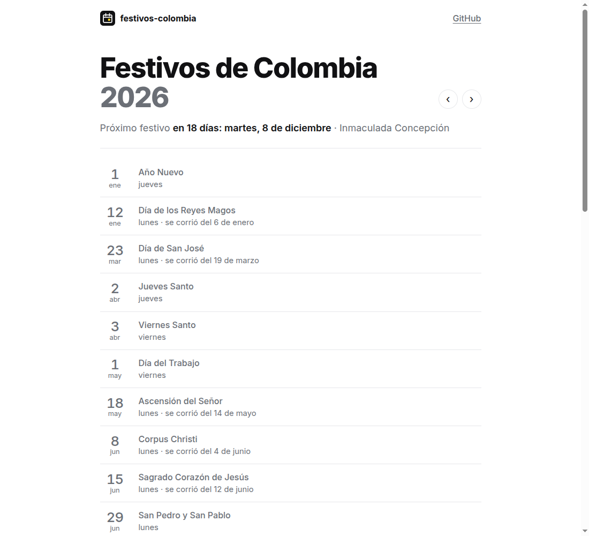

# festivos-colombia

Festivos de Colombia de cualquier año y cálculo de días hábiles, en JavaScript, sin dependencias y con tipos para TypeScript.

**Página para consultarlos:** https://eliasgdev.github.io/festivos-colombia/



## Por qué

Las listas de festivos copiadas a mano se vencen cada año, y muchos cálculos de plazos (entregas, vencimientos, tiempos de respuesta) fallan por un lunes festivo. Esta librería calcula los festivos con las reglas de la ley, así que sirve para cualquier año desde 1984.

## Instalación

```bash
npm install github:eliasgdev/festivos-colombia
```

## Uso

```js
import {
  festivos, esFestivo, nombreFestivo, esDiaHabil,
  sumarDiasHabiles, diasHabilesEntre, siguienteFestivo, festivosEntre,
} from 'festivos-colombia';

festivos(2026);
// [{ fecha: '2026-01-01', nombre: 'Año Nuevo', original: '2026-01-01', trasladado: false },
//  { fecha: '2026-01-12', nombre: 'Día de los Reyes Magos', original: '2026-01-06', trasladado: true }, …]

esFestivo('2026-11-16');                  // true
nombreFestivo('2026-04-03');              // 'Viernes Santo'
esDiaHabil(new Date(2026, 10, 21));       // false (sábado)

sumarDiasHabiles('2026-11-13', 1);        // '2026-11-17': salta el fin de semana y el lunes festivo
sumarDiasHabiles('2026-04-06', -1);       // '2026-04-01': hacia atrás, saltando Semana Santa
diasHabilesEntre('2026-01-01', '2026-12-31');  // 243

siguienteFestivo('2026-11-20');           // { fecha: '2026-12-08', nombre: 'Inmaculada Concepción', … }
festivosEntre('2026-12-01', '2027-01-15');     // festivos de diciembre y enero
```

### Opciones de días hábiles

```js
// Comercio o entidades que trabajan el sábado
esDiaHabil('2026-11-21', { sabadoHabil: true });  // true

// Días no hábiles propios: cierres de la empresa, días cívicos, etc.
sumarDiasHabiles('2026-12-21', 3, { extra: ['2026-12-24', '2026-12-31'] });
```

### Fechas

Se aceptan textos `'YYYY-MM-DD'` u objetos `Date`; de un `Date` se toman el año, el mes y el día locales. Las respuestas siempre son `'YYYY-MM-DD'`. Como no se hacen cálculos con horas, el resultado no cambia con la zona horaria del servidor (un problema frecuente al desplegar en servidores en UTC).

Una fecha que no existe (`'2026-02-30'`) o mal escrita lanza `TypeError`. Un año fuera del rango 1984–9999 lanza `RangeError`.

## Línea de comandos

```bash
npx github:eliasgdev/festivos-colombia 2027          # festivos del año
npx github:eliasgdev/festivos-colombia es 2026-12-08 # código de salida 0 si es festivo
npx github:eliasgdev/festivos-colombia sumar 2026-11-13 5
npx github:eliasgdev/festivos-colombia entre 2026-11-01 2026-11-30 --sabados
npx github:eliasgdev/festivos-colombia siguiente --json
```

El código de salida de `es` sirve en scripts y en tareas programadas, por ejemplo para no correr un proceso en festivo:

```bash
festivos-colombia es "$(date +%F)" > /dev/null || ./cierre-diario.sh
```

## Reglas que aplica

| Festivo | Fecha | ¿Se corre al lunes? |
|---|---|---|
| Año Nuevo | 1 de enero | No |
| Reyes Magos | 6 de enero | Sí |
| San José | 19 de marzo | Sí |
| Jueves y Viernes Santo | Pascua − 3 y − 2 días | No |
| Día del Trabajo | 1 de mayo | No |
| Ascensión del Señor | Pascua + 39 días | Sí |
| Corpus Christi | Pascua + 60 días | Sí |
| Sagrado Corazón | Pascua + 68 días | Sí |
| San Pedro y San Pablo | 29 de junio | Sí |
| Independencia | 20 de julio | No |
| Batalla de Boyacá | 7 de agosto | No |
| Asunción de la Virgen | 15 de agosto | Sí |
| Día de la Raza | 12 de octubre | Sí |
| Todos los Santos | 1 de noviembre | Sí |
| Independencia de Cartagena | 11 de noviembre | Sí |
| Inmaculada Concepción | 8 de diciembre | No |
| Navidad | 25 de diciembre | No |

- Los traslados son los de la Ley 51 de 1983 («Ley Emiliani»). El Domingo de Pascua se calcula con el algoritmo de Meeus/Jones/Butcher para el calendario gregoriano.
- Dos festivos pueden caer el mismo lunes; el 30 de junio de 2025 coincidieron Sagrado Corazón y San Pedro. `festivos()` devuelve las dos entradas y `nombreFestivo()` las une.
- Las pruebas comparan los años 2024, 2025 y 2026 contra los calendarios oficiales. También revisan que de 1984 a 2100 siempre haya 18 festivos y que todo festivo trasladado caiga en lunes.

## Desarrollo

```bash
npm test        # node:test, Node 18 o superior
npm start       # página en http://localhost:8080
```

Las pruebas corren en Node 18, 20, 22 y 24 en cada cambio. La página se publica en GitHub Pages desde `main`.

## Origen

Lo saqué de proyectos privados donde hacía falta calcular plazos en días hábiles y no había una librería pequeña, sin dependencias y en español que lo resolviera.

## Licencia

MIT. La fuente Inter de la página usa la SIL Open Font License.
